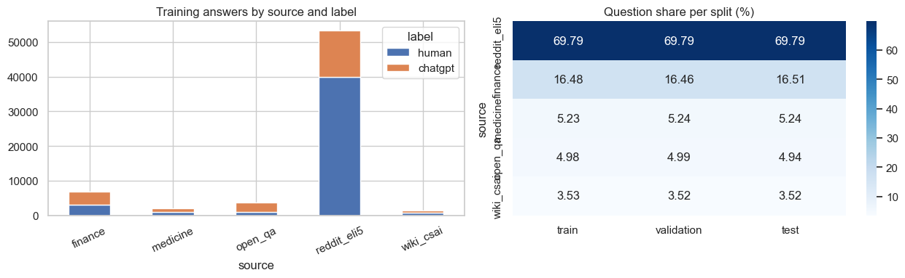
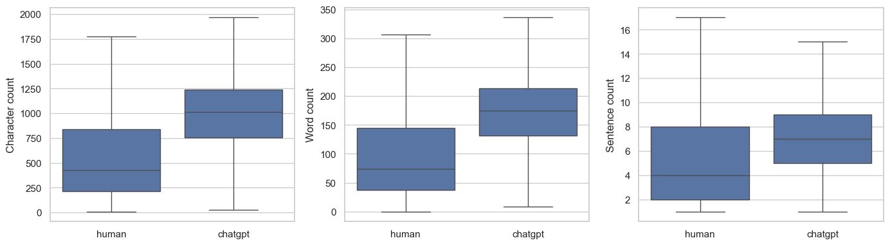
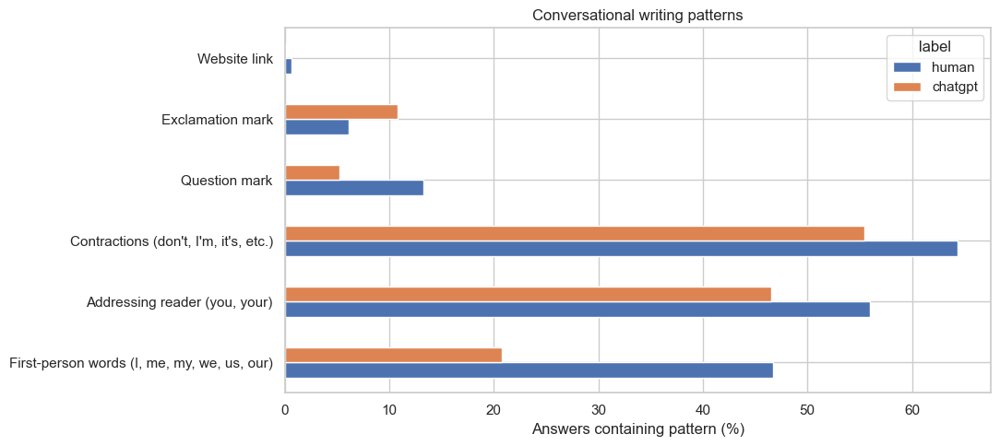
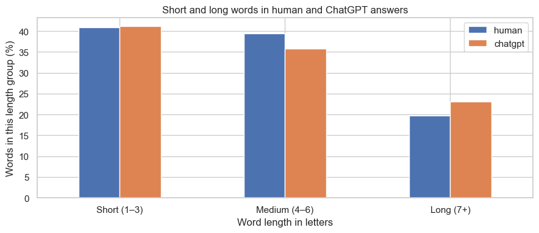

# Spot the Bot- Detecting AI Generated Text

This project explores how to distinguish human-written text from ChatGPT-generated text using the HC3 dataset. We compare answer length, vocabulary, punctuation, and writing patterns to understand the data before building a text classifier.

---

### 👥 **Team Members**

**Example:**

| Name              | GitHub Handle   | Contribution                                                                                                       |
|-------------------|-----------------|--------------------------------------------------------------------------------------------------------------------|
| Abdulahi Oyebanji | @abdulahi-banji |                                                                                                                    |
| Austin Xu         | @austxu         |                                                                                                                    |
| Matthew Han       | @matthewjyhan   |                                                                                                                    |
| Angelina Yeh      | @AngelinaY17    |                                                                                                                    |
| Leah Torres       | @lctorr         |                                                                                                                    |
| Allyson Keightley | @akeight        | Project organization, dataset preperation, model selection, hyperparameter tuning, model training and optimization |
| Brian Casio       | @briancasio     |                                                                                                                    |


---

## 🎯 **Project Highlights**

**Example:**

- Developed a machine learning model using `[model type/technique]` to address `[challenge project task]`.
- Achieved `[key metric or result]`, demonstrating `[value or impact]` for `[host company]`.
- Generated actionable insights to inform business decisions at `[host company or stakeholders]`.
- Implemented `[specific methodology]` to address industry constraints or expectations.

---

## 👩🏽‍💻 **Setup and Installation**

### Prepare the data and notebooks

1. Install Python 3.12 and clone the repository:

   ```bash
   git clone https://github.com/Break-Through-Tech/Chewy-1B-spot-the-bot-detecting-ai-generated-text.git
   cd Chewy-1B-spot-the-bot-detecting-ai-generated-text
   ```

2. From the repository root, create an environment and install the project packages:

   ```bash
   python3.12 -m venv .venv
   source .venv/bin/activate
   python -m pip install --upgrade pip
   python -m pip install -r requirements.txt
   ```

3. Download the full HC3 corpus (about 147 MB):

   ```bash
   python data/download_hc3.py
   ```

   The script writes `data/hc3_all.csv`. The raw file is generated locally and is not committed.
4. Run data preparation first. From the repository root, start Jupyter in the data notebook folder:

   ```bash
   cd notebooks/data
   jupyter lab
   ```

   Run `data_cleaning.ipynb`, then `dataset_splitting.ipynb`.
5. For modeling and evaluation, start Jupyter from the relevant folder (the notebooks use paths relative to their folder):

   ```bash
   cd notebooks/tfidf        # or notebooks/embeddings, notebooks/evaluation
   jupyter lab
   ```

### Run the demo locally

The model artifacts are included in `backend/models/`.

1. In a terminal, install and start the FastAPI backend:

   ```bash
   cd backend
   python3.12 -m venv .venv
   source .venv/bin/activate
   python -m pip install --upgrade pip
   python -m pip install -r requirements.txt
   uvicorn app.main:app --reload --port 8000
   ```

2. In another terminal, configure and start the Next.js frontend:

   ```bash
   cd frontend
   cat > .env.local <<'EOF'
   FASTAPI_URL=http://127.0.0.1:8000
   EOF
   npm ci
   npm run dev
   ```

3. Open <http://localhost:3000>. The backend health check and interactive API docs are at <http://127.0.0.1:8000/health> and <http://127.0.0.1:8000/docs>.

The model returns an experimental score, not proof of authorship. See [backend setup and deployment notes](backend/README.md) for service configuration.

---

## 🏗️ **Project Overview**

**Describe:**

- How this project is connected to the Break Through Tech AI Program
- Your AI Studio host company and the project objective and scope
- The real-world significance of the problem and the potential impact of your work

---

## 📊 **Data Exploration**

Our [EDA notebook](notebooks/data/eda.ipynb) analyzes **67,232 training answers** from the updated HC3 cleaning and splitting pipeline. Here are some of the charts from our exploration.

**Dataset balance:** human answers make up about 68% of training, and Reddit ELI5 is the largest domain.



**Answer length:** human answers have a median of 74 words, compared with 175 for ChatGPT. This helps us check whether a detector might rely too much on length.



**Writing style:** we compare personal language, contractions, questions, exclamations, and links as possible clues for the detector.



**Word length:** this chart compares the proportion of short, medium, and long words in each class.



These patterns describe our dataset; no single pattern proves that an answer was written by AI.

---

## 🧠 **Model Development**

**You might consider describing the following (as applicable):**

* Model(s) used (e.g., CNN with transfer learning, regression models)
* Feature selection and Hyperparameter tuning strategies
* Training setup (e.g., % of data for training/validation, evaluation metric, baseline performance)


---

## 📈 **Results & Key Findings**

**You might consider describing the following (as applicable):**

* Performance metrics (e.g., Accuracy, F1 score, RMSE)
* How your model performed
* Insights from evaluating model fairness

**Potential visualizations to include:**

* Confusion matrix, precision-recall curve, feature importance plot, prediction distribution, outputs from fairness or explainability tools

---

## 🚀 **Next Steps**

**You might consider addressing the following (as applicable):**

* What are some of the limitations of your model?
* What would you do differently with more time/resources?
* What additional datasets or techniques would you explore?

---

## 📝 **License**

Specify how your project can be used by others. Choose an appropriate license and link it here (e.g., MIT, Apache 2.0). Make sure your Challenge Advisor approves of the selected license type. 

**Example:**
This project is licensed under the MIT License.

---

## 📄 **References** (Optional but encouraged)

Cite relevant papers, articles, or resources that supported your project.

---

## 🙏 **Acknowledgements** (Optional but encouraged)

Thank your Challenge Advisor, host company representatives, TA, and others who supported your project.
