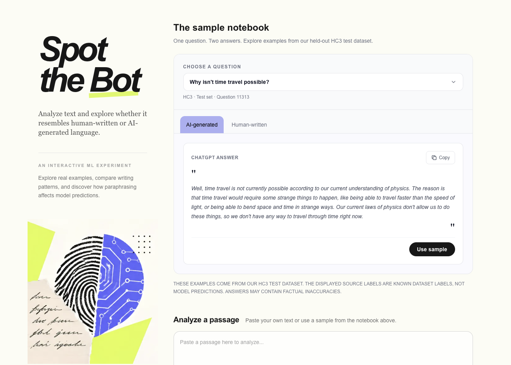
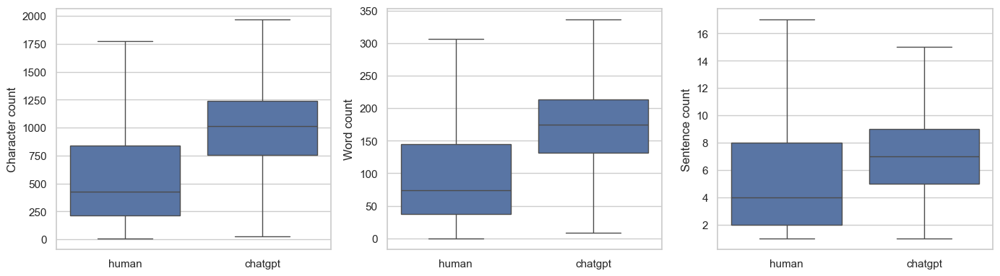
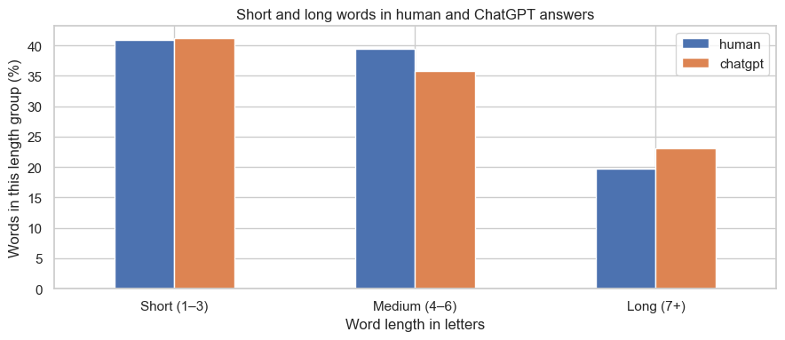
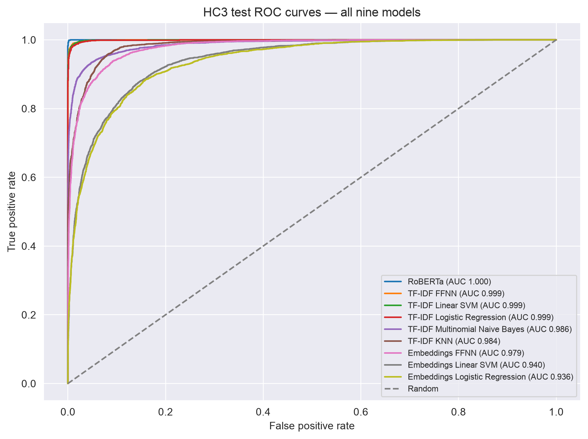
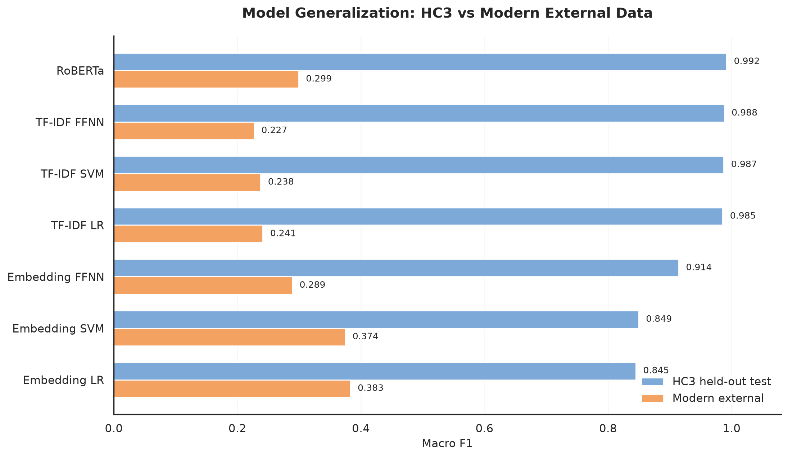
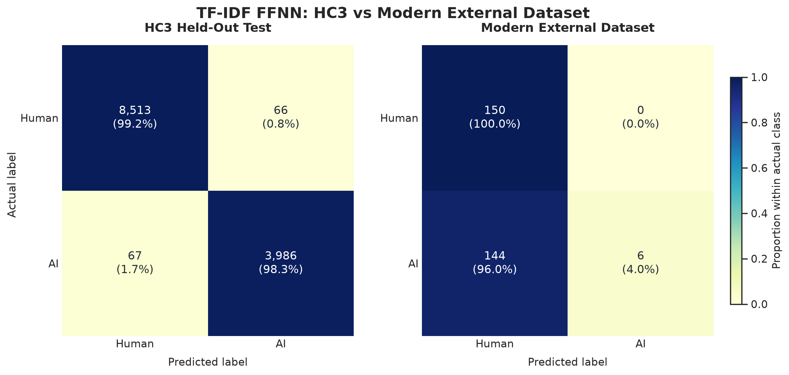
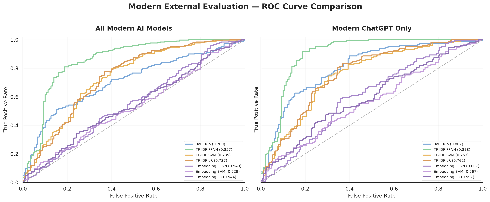
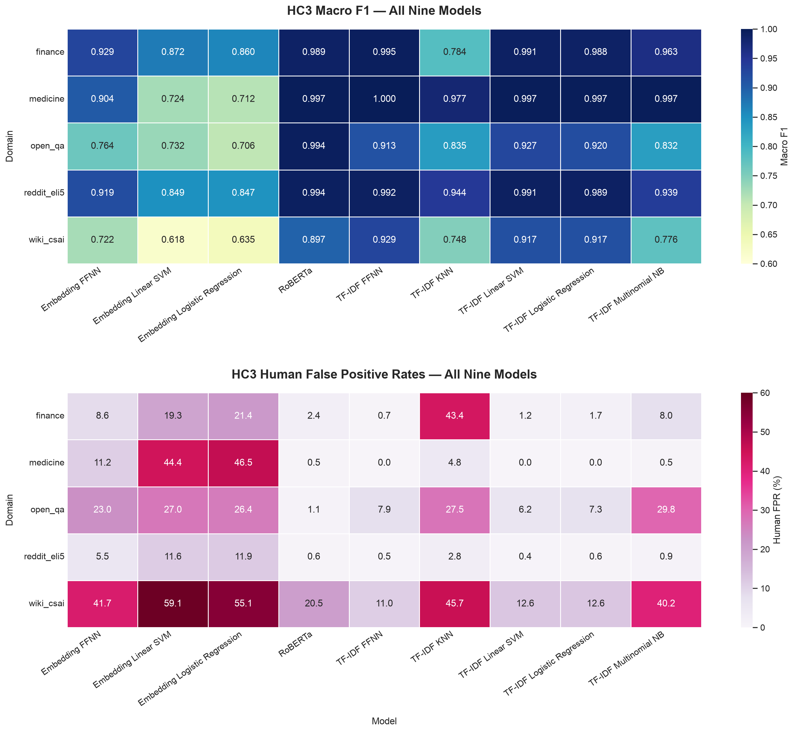
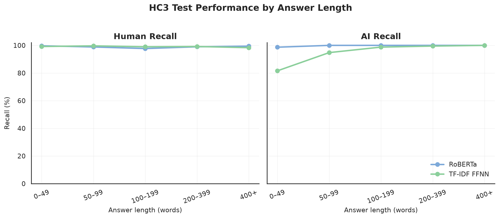

# Spot the Bot – Detecting AI-Generated Text

Spot the Bot is a machine learning and natural language processing (NLP) project that explores the challenges of distinguishing human-written text from AI-generated content.

Using the Human ChatGPT Comparison Corpus (HC3), our team analyzed differences in answer length, vocabulary, punctuation, and writing patterns before developing and comparing traditional machine learning classifiers, feedforward neural networks, sentence embedding models, and a fine-tuned RoBERTa transformer.

Beyond classification accuracy, we investigated how well these models generalize to modern AI-generated text from ChatGPT, Claude, and Gemini. Our findings highlight both the strengths of text classification models and the challenges of detecting AI-generated content as language models continue to evolve.

---

### 👥 **Team Members**

**Example:**

| Name              | GitHub Handle   | Contribution                                                                                                                                                                                                           |
|-------------------|-----------------|------------------------------------------------------------------------------------------------------------------------------------------------------------------------------------------------------------------------|
| Abdulahi Oyebanji | @abdulahi-banji |                                                                                                                                                                                                                        |
| Austin Xu         | @austxu         |                                                                                                                                                                                                                        |
| Matthew Han       | @matthewjyhan   |                                                                                                                                                                                                                        |
| Angelina Yeh      | @AngelinaY17    |                                                                                                                                                                                                                        |
| Leah Torres       | @lctorr         |                                                                                                                                                                                                                        |
| Allyson Keightley | @akeight        | Project organization, dataset splitting and preparation, model development (FFNN, sentence embeddings, RoBERTa), hyperparameter tuning, cross-domain and external dataset evaluation, and demo development/deployment. |
| Brian Casio       | @briancasio     |                                                                                                                                                                                                                        |


---

## 🎯 **Project Highlights**

- Developed an AI-generated text detection solution to support Chewy's vendor vetting process, helping assess the authenticity of vendor-submitted content and inform more reliable screening decisions.

- Built and evaluated classical machine learning, feed-forward neural network, sentence-embedding, and fine-tuned RoBERTa models to distinguish AI-generated text from human-written text.

- Achieved approximately 99% validation accuracy with a TF-IDF feed-forward neural network, demonstrating strong classification performance on the original dataset.

- Evaluated model generalization using a modern external dataset containing ChatGPT, Claude, and Gemini-generated text, including domain-level analysis to identify model strengths and limitations.

- Built a lightweight, full-stack web application using Next.js and FastAPI to demonstrate AI-generated text detection through an interactive interface.

<p align="center">
  
</p>

---

## 👩🏽‍💻 **Setup and Installation**

### Prepare the data and notebooks

1. Install Python 3.12 and clone the repository:

   ```bash
   git clone https://github.com/Break-Through-Tech/Chewy-1B-spot-the-bot-detecting-ai-generated-text.git
   cd Chewy-1B-spot-the-bot-detecting-ai-generated-text
   ```

2. From the repository root, create an environment and install the project packages:

   ```bash
   python3.12 -m venv .venv
   source .venv/bin/activate
   python -m pip install --upgrade pip
   python -m pip install -r requirements.txt
   ```

3. Download the full HC3 corpus (about 147 MB):

   ```bash
   python data/download_hc3.py
   ```

   The script writes `data/hc3_all.csv`. The raw file is generated locally and is not committed.
4. Run data preparation first. From the repository root, start Jupyter in the data notebook folder:

   ```bash
   cd notebooks/data
   jupyter lab
   ```

   Run `data_cleaning.ipynb`, then `dataset_splitting.ipynb`.
5. For modeling and evaluation, start Jupyter from the relevant folder (the notebooks use paths relative to their folder):

   ```bash
   cd notebooks/tfidf        # or notebooks/embeddings, notebooks/evaluation
   jupyter lab
   ```

### Run the demo locally

The model artifacts are included in `backend/models/`.

1. In a terminal, install and start the FastAPI backend:

   ```bash
   cd backend
   python3.12 -m venv .venv
   source .venv/bin/activate
   python -m pip install --upgrade pip
   python -m pip install -r requirements.txt
   uvicorn app.main:app --reload --port 8000
   ```

2. In another terminal, configure and start the Next.js frontend:

   ```bash
   cd frontend
   cat > .env.local <<'EOF'
   FASTAPI_URL=http://127.0.0.1:8000
   EOF
   npm ci
   npm run dev
   ```

3. Open <http://localhost:3000>. The backend health check and interactive API docs are at <http://127.0.0.1:8000/health> and <http://127.0.0.1:8000/docs>.

The model returns an experimental score, not proof of authorship. See [backend setup and deployment notes](backend/README.md) for service configuration.

---

## 🏗️ Project Overview

**Spot the Bot** was developed through the **Break Through Tech AI Studio (Fall 2026)** program in collaboration with [Chewy](https://www.chewy.com/). This industry-sponsored challenge provided our team with an opportunity to apply machine learning and natural language processing (NLP) techniques to a real-world problem involving content authenticity and the reliability of AI-generated text detection.

### Business Objective and Significance

As generative AI becomes increasingly sophisticated and accessible, distinguishing human-written content from AI-generated text presents growing challenges for businesses, educational institutions, and online platforms.

For Chewy, one potential application is supporting **vendor verification and content authenticity assessments**. AI-generated text detection could serve as an additional signal when reviewing vendor-submitted information, helping identify content that may require further investigation and supporting more informed verification processes.

Beyond business applications, the challenge also addresses broader concerns surrounding **content authenticity and academic integrity**, where understanding whether text was written by a person or generated by AI can be important.

However, AI-generated content is not inherently fraudulent, and automated detection alone cannot establish authenticity. Understanding the reliability and limitations of these systems is essential before considering them for real-world use.

### Project Scope

The challenge focused on developing supervised classification models to distinguish human-written from AI-generated text and evaluating their performance using established machine learning metrics.

A component of the project was adversarial robustness evaluation: investigating how well AI-text detectors withstand lightly paraphrased or humanized AI-generated content intended to evade detection. This helps reveal vulnerabilities that may not be apparent from traditional classification metrics alone.

Our team expanded the original modeling scope by evaluating additional feature representations, including TF-IDF and pretrained sentence embeddings, alongside traditional machine learning classifiers, feedforward neural networks, and a fine-tuned RoBERTa transformer. We also investigated dataset drift by evaluating model performance on modern AI-generated responses from ChatGPT, Claude, and Gemini, and conducted domain-specific analyses to better understand classification reliability and generalization across different types of content.

To demonstrate the practical application of our work, we developed an interactive web application that allows users to submit text and receive a human-versus-AI classification prediction.

Ultimately, Spot the Bot aims to explore **not only whether AI-generated text can be detected, but learning the process of how these detection methods perform when faced with evolving language models, changing writing patterns, and attempts to evade detection**.

---

## 📊 **Data Exploration**

Our [EDA notebook](notebooks/data/eda.ipynb) analyzes **67,232 training answers** from the updated HC3 cleaning and splitting pipeline. Here are some of the charts from our exploration.

**Dataset balance:** human answers make up about 68% of training, and Reddit ELI5 is the largest domain.


**Answer length:** human answers have a median of 74 words, compared with 175 for ChatGPT. This helps us check whether a detector might rely too much on length.



**Writing style:** we compare personal language, contractions, questions, exclamations, and links as possible clues for the detector.


**Word length:** this chart compares the proportion of short, medium, and long words in each class.



These patterns describe our dataset; no single pattern proves that an answer was written by AI.

---

## 🧠 Model Development

### Models and Architectures

- **Classical Machine Learning:** Trained Logistic Regression (baseline), Linear SVM, K-Nearest Neighbors (KNN), and Multinomial Naive Bayes classifiers using TF-IDF features.
- **Feedforward Neural Networks:** Developed and evaluated dense neural networks using TF-IDF features and pretrained sentence embeddings.
- **Sentence Embedding Experiments:** Replaced TF-IDF features with pretrained sentence embeddings to evaluate Logistic Regression, Linear SVM, and FFNN classifiers, comparing how different text representations influence classification performance.
- **Transformer:** Fine-tuned RoBERTa (`roberta-base`) for binary text classification. The resulting model is published on Hugging Face: [Spot the Bot RoBERTa](https://huggingface.co/akeight/spot-the-bot-roberta).

### Feature Engineering and Text Representations

- **TF-IDF:** Extracted unigram and bigram features with a 100,000-feature limit, `min_df=2`, and sublinear term-frequency scaling.
- **Sentence Embeddings:** Used [sentence-transformers/all-MiniLM-L6-v2](https://huggingface.co/sentence-transformers/all-MiniLM-L6-v2) to generate 384-dimensional semantic embeddings for downstream classification.
- **RoBERTa:** Used the tokenizer and pretrained weights from [FacebookAI/roberta-base](https://huggingface.co/FacebookAI/roberta-base), fine-tuning the transformer to learn contextual representations for AI-generated text detection.

### Hyperparameter Tuning and Optimization

- **Classical ML:** Compared model performance across multiple algorithms and training configurations.
- **TF-IDF Feed-Forward Neural Network:** Conducted **19 documented experiments** exploring network architectures, learning rates, dropout, early stopping, and training optimization. [View experiments](docs/tfidf_nn_model_experiments.md).
- **Sentence Embedding Feed-Forward Neural Network:** Conducted **7 documented experiments** evaluating neural network configurations and optimization strategies using pretrained sentence embeddings. [View experiments](docs/embedding_nn_model_experiments.md).
- **RoBERTa:** Fine-tuned the pretrained transformer, experimenting with sequence lengths and training configurations while managing computational constraints.

### Training and Evaluation

- **Data Splitting:** Used a stratified **70/15/15 train/validation/test split** at the question level to reduce data leakage.
- **Baseline:** Established Logistic Regression with TF-IDF features as the baseline model.
- **Evaluation Metrics:** Evaluated models using accuracy, precision, recall, F1-score, ROC-AUC, and confusion matrices.
- **External Evaluation:** Evaluated model generalization on a modern dataset containing ChatGPT, Claude, and Gemini-generated text to investigate performance under dataset shift. [View dataset drift findings](docs/modern_dataset_drift_analysis_findings.md).
- **Domain-Level Analysis:** Analyzed model performance across subject domains to identify strengths, weaknesses, and generalization limitations. [View domain-level analysis findings](docs/hc3_domain_evaluation_findings.md).

---

## 📈 **Results & Key Findings**

### HC3 Held-Out Test Set Performance

All nine trained classifiers were evaluated on the same held-out HC3 test set (12,632 responses). Results reflect the original saved models and decision rules.

| Model | Feature Type |   Accuracy |   Macro F1 |    ROC-AUC | Human Recall | AI Recall | Human FPR |
|---|---|-----------:|-----------:|-----------:|---:|---:|---:|
| RoBERTa | Transformer | **99.27%** | **0.9917** | **0.9999** | 98.94% | 99.98% | 1.06% |
| TF-IDF FFNN | TF-IDF |     98.95% |     0.9879 |     0.9994 | 99.23% | 98.35% | 0.77% |
| TF-IDF Linear SVM | TF-IDF |     98.88% |     0.9872 |     0.9992 | 99.24% | 98.12% | 0.76% |
| TF-IDF Logistic Regression | TF-IDF |     98.73% |     0.9854 |     0.9991 | 99.06% | 98.03% | 0.94% |
| TF-IDF Multinomial NB | TF-IDF |     95.04% |     0.9423 |     0.9865 | 97.44% | 89.96% | 2.56% |
| TF-IDF KNN | TF-IDF |     93.41% |     0.9260 |     0.9837 | 93.19% | 93.88% | 6.81% |
| Embeddings FFNN | Sentence Embeddings |     92.42% |     0.9141 |     0.9785 | 93.29% | 90.60% | 6.71% |
| Embeddings Linear SVM | Sentence Embeddings |     86.35% |     0.8494 |     0.9403 | 86.13% | 86.82% | 13.87% |
| Embeddings Logistic Regression | Sentence Embeddings |     85.93% |     0.8448 |     0.9360 | 85.76% | 86.31% | 14.24% |


**ROC Curves — HC3 Held-Out Test Set**



**Understanding ROC Curves and ROC-AUC:** ROC curves show how well a model distinguishes between human-written and AI-generated text across different classification thresholds. Each curve illustrates the trade-off between correctly detecting AI-generated responses and incorrectly labeling human-written responses as AI. ROC-AUC summarizes this performance into a single score, where 1.0 represents perfect separation and 0.5 is equivalent to random guessing. Curves closer to the top-left corner indicate stronger performance. On the HC3 test set, most models achieved exceptionally high ROC-AUC scores, indicating they could effectively distinguish between the two classes.


**Key findings:**
- RoBERTa achieved the highest overall test accuracy (99.27%) and macro F1 (0.9917).
- The TF-IDF FFNN was the strongest non-transformer model, reaching 98.95% accuracy.
- Traditional TF-IDF classifiers performed competitively with the substantially larger transformer model.
- Human false-positive rate (FPR) measures the percentage of human-written responses incorrectly classified as AI-generated.

**Source:** [HC3 model comparison notebook](notebooks/evaluation/hc3_model_comparison.ipynb) | [Saved test metrics](data/evaluation/hc3_model_metrics.csv)


### Modern External Dataset Evaluation

Seven classifiers were evaluated on an independent dataset of 600 modern responses from human writers and three AI generators: ChatGPT, Claude, and Gemini.

This experiment assesses generalization beyond the original HC3 training distribution.




**Understanding the comparison:** This chart shows how well each model identifies human-written versus AI-generated text on two different datasets. Macro F1 measures how well a model balances correct predictions across both categories, with scores closer to 1.0 indicating better performance. While the models performed exceptionally well on the original HC3 test set, their scores dropped significantly when evaluated on newer AI-generated responses from ChatGPT, Claude, and Gemini. This demonstrates **dataset distribution shift**: patterns the models learned from older examples did not transfer reliably to newer content.

| Model | Accuracy | Macro F1 | ROC-AUC | Human FPR | AI Recall |
|---|---:|---:|---:|---:|---:|
| RoBERTa | 32.00% | 0.2989 | 0.7088 | 1.33% | 9.78% |
| TF-IDF FFNN | 26.83% | 0.2268 | **0.8574** | **0.00%** | **2.44%** |
| TF-IDF Linear SVM | 27.50% | 0.2375 | 0.7348 | 0.67% | 3.56% |
| TF-IDF Logistic Regression | 27.67% | 0.2410 | 0.7369 | 1.33% | 4.00% |
| Embeddings FFNN | 30.50% | 0.2886 | 0.5493 | 8.67% | 10.22% |
| Embeddings Linear SVM | 37.50% | 0.3744 | 0.5295 | 18.67% | 22.89% |
| **Embeddings Logistic Regression** | **38.33%** | **0.3828** | 0.5438 | 17.33% | **23.56%** |


**TF-IDF FFNN — HC3 vs. Modern External Dataset**



The selected model performed strongly on HC3 but misclassified 439 of 450 modern AI-generated responses as human, demonstrating a substantial decline in AI detection recall.


**ROC Curves — Modern External Evaluation**



**Comparing Modern AI Detection:** These ROC curves compare how effectively seven classifiers distinguish human-written responses from AI-generated content across two evaluation settings. The left panel includes ChatGPT, Claude, and Gemini, while the right focuses exclusively on modern ChatGPT. This comparison helps determine whether poor generalization extends beyond differences between AI providers.

Despite poor classification performance at its original decision threshold, the TF-IDF FFNN achieved the highest ROC-AUC (0.8574) on the full modern dataset. This suggests that its prediction scores retain useful ranking information, even though the model rarely identifies modern AI-generated responses correctly at its existing threshold.

**Baseline comparison:** A majority-class classifier that always predicts AI would achieve 75% accuracy on the full modern dataset. All seven models fall below this baseline, highlighting the substantial decline in classification performance under distribution shift.

**Key findings:**

- **Significant performance degradation:** All seven classifiers experienced substantial declines in classification performance compared with their original HC3 results.
- **Highest accuracy:** Embeddings Logistic Regression achieved the highest modern accuracy (38.33%), but with a relatively high human false-positive rate (17.33%).
- **Poor detection of modern AI:** The TF-IDF FFNN detected only 11 of 450 AI-generated responses (2.44% AI recall) across ChatGPT, Claude, and Gemini, despite correctly identifying all 150 human-written responses.
- **Poor generalization persists on ChatGPT alone:** On the balanced subset of 150 human-written and 150 modern ChatGPT-generated responses, the TF-IDF FFNN achieved 52.00% accuracy but detected only 6 of 150 ChatGPT responses (4.00% AI recall). This demonstrates that the performance decline is not limited to comparisons across different AI providers, although other dataset differences may contribute.

**Important:** The full modern dataset contains 75% AI-generated responses, while the ChatGPT-only subset contains 50%. Accuracy should therefore be interpreted alongside macro F1, ROC-AUC, and class-specific recall when comparing these evaluations.

**Source:** [Modern model comparison notebook](notebooks/evaluation/modern_model_comparison.ipynb) | [Saved external metrics](data/evaluation/modern_seven_model_comparison.csv)


### HC3 Domain-Specific Evaluation

All nine classifiers were evaluated across five HC3 domains using the held-out test set. Macro F1 is reported to account for differences in class distribution across domains.

| Model | Finance | Medicine | Open QA | Reddit ELI5 | Wiki CS/AI |
|---|---:|---:|---:|---:|---:|
| RoBERTa | 0.9890 | 0.9974 | **0.9944** | **0.9936** | 0.8966 |
| **TF-IDF FFNN** | **0.9953** | **1.0000** | 0.9132 | 0.9919 | **0.9290** |
| TF-IDF Linear SVM | 0.9906 | 0.9974 | 0.9274 | 0.9911 | 0.9172 |
| TF-IDF Logistic Regression | 0.9882 | 0.9974 | 0.9201 | 0.9893 | 0.9172 |
| TF-IDF Multinomial NB | 0.9629 | 0.9974 | 0.8324 | 0.9391 | 0.7758 |
| TF-IDF KNN | 0.7835 | 0.9767 | 0.8350 | 0.9440 | 0.7480 |
| Embeddings FFNN | 0.9293 | 0.9044 | 0.7641 | 0.9190 | 0.7225 |
| Embeddings Linear SVM | 0.8715 | 0.7237 | 0.7322 | 0.8489 | 0.6179 |
| Embeddings Logistic Regression | 0.8601 | 0.7117 | 0.7056 | 0.8472 | 0.6349 |


**Domain-Level Performance and Human False-Positive Rates**



Domain-level evaluation revealed meaningful performance differences, including elevated human false-positive rates for some classifiers on Wiki CS/AI.


**HC3 test samples by domain:**
- Reddit ELI5: 9,997
- Finance: 1,283
- Open QA: 710
- Medicine: 388
- Wiki CS/AI: 254

**Key findings:**
- RoBERTa achieved the highest macro F1 on Reddit ELI5 and Open QA.
- TF-IDF FFNN performed best on Finance, Medicine, and Wiki CS/AI.
- Performance varied substantially by domain, particularly for embedding-based classifiers.
- Wiki CS/AI presented a notable challenge. RoBERTa achieved 89.76% accuracy in this domain, with a 20.47% human false-positive rate.
- Domain-level variation demonstrates why overall accuracy alone is insufficient to characterize model reliability.

**Source:** [HC3 domain evaluation notebook](notebooks/evaluation/hc3_domain_evaluation.ipynb)


### Answer-Length Sensitivity

To investigate whether answer length influenced classification performance, we evaluated RoBERTa and the TF-IDF FFNN across five answer-length groups within the HC3 held-out test set.



**Key findings:**
- For short AI-generated responses (0–49 words), RoBERTa achieved 98.68% AI recall compared with 81.58% for the TF-IDF FFNN.
- TF-IDF FFNN recall improved substantially for longer responses, suggesting sensitivity to answer length or the availability of linguistic features.
- The 400+ word group contained only three AI-generated examples, limiting conclusions for that category.

These findings highlight potential length-related dataset shortcuts, although length alone cannot be established as the cause of the observed performance differences.


---

## 🚀 Next Steps

While our models achieved strong classification performance on the original HC3 dataset, external evaluations revealed limitations in generalizing to modern AI-generated text. The HC3 dataset, released in 2023, primarily contains responses from early ChatGPT models and may not adequately represent the capabilities, writing styles, and linguistic patterns of newer large language models.

Our modern dataset drift evaluation demonstrated that the models were more effective at identifying human-written text than detecting AI-generated responses from newer models. These findings highlight the importance of evaluating model robustness beyond the original training distribution.

### Future Improvements and Research

- **Expand External Dataset Evaluation:** Evaluate models against additional independent datasets, including [RAID](https://arxiv.org/abs/2406.08455), to assess generalization across older and newer language models, diverse domains, and different text-generation techniques.

- **Investigate Misclassification Patterns:** Conduct deeper analysis of false positives and false negatives across the original HC3 and modern external datasets to identify linguistic patterns, model-specific weaknesses, and potential causes of reduced detection performance on newer AI-generated text.

- **Refine TF-IDF Feature Engineering:** Conduct controlled experiments varying `ngram_range`, `max_features`, `min_df`, `max_df`, and `sublinear_tf` to determine how feature representation influences classification performance and generalization across classical ML and neural network models.

- **Improve Neural Network Optimization:** Compare early stopping strategies, experiment with dropout and label smoothing, and monitor precision, recall, F1-score, and ROC-AUC alongside binary cross-entropy loss.

- **Explore Efficient Transformer Fine-Tuning:** Investigate LoRA and QLoRA as parameter-efficient alternatives for fine-tuning RoBERTa and other transformer architectures. Explore longer input sequences and additional training configurations to improve contextual understanding while reducing computational requirements.

- **Expand Training Data Diversity:** Incorporate newer AI-generated text from multiple language models, domains, and writing styles to reduce reliance on early ChatGPT patterns and improve detection of contemporary AI-generated content.

- **Validate Real-World Applicability:** Evaluate performance on representative vendor-submitted content, including human-edited AI-generated text, to assess reliability and potential usefulness in Chewy's vendor vetting process.

- **Compare Alternative Text Embeddings:** Evaluate pretrained [GloVe 6B 300d embeddings](https://huggingface.co/sentence-transformers/average_word_embeddings_glove.6B.300d) against our existing [all-MiniLM-L6-v2 sentence embeddings](https://huggingface.co/sentence-transformers/all-MiniLM-L6-v2) using the same downstream classifiers (FFNN, Logistic Regression, and SVM). Compare classification performance, computational efficiency, and generalization to modern AI-generated text to determine how different embedding representations influence detection reliability.

---

## 📝 License

This project is licensed under the [MIT License](LICENSE). See the `LICENSE` file for details.

---

## 📄 References

The following research papers, datasets, and pretrained models supported the development and evaluation of this project.

### Research Papers and Datasets

- **HC3: Human ChatGPT Comparison Corpus** — Guo et al. (2023). *How Close is ChatGPT to Human Experts? Comparison Corpus, Evaluation, and Detection.* [arXiv:2301.07597](https://arxiv.org/abs/2301.07597)
- **RoBERTa** — Liu et al. (2019). *RoBERTa: A Robustly Optimized BERT Pretraining Approach.* [arXiv:1907.11692](https://arxiv.org/abs/1907.11692)
- **Sentence-BERT** — Reimers & Gurevych (2019). *Sentence-BERT: Sentence Embeddings using Siamese BERT-Networks.* [arXiv:1908.10084](https://arxiv.org/abs/1908.10084)
- **Comparative Text Classification Methods** — Petridis, C. (2024). *Text Classification: Neural Networks VS Machine Learning Models VS Pre-trained Models.* arXiv:2412.21022. [Read paper](https://arxiv.org/abs/2412.21022)

### Modern External Evaluation Dataset

- **Stack Exchange** — [Stack Exchange Network](https://stackexchange.com/) | [Stack Exchange API](https://api.stackexchange.com/docs)

  Human-written questions and answers were collected from Stack Exchange to construct an independent modern evaluation dataset. Corresponding AI-generated responses were produced using ChatGPT, Claude, and Gemini.

### Pretrained Models

- **RoBERTa Base** — [FacebookAI/roberta-base](https://huggingface.co/FacebookAI/roberta-base)
- **Sentence Embeddings (all-MiniLM-L6-v2)** — [sentence-transformers/all-MiniLM-L6-v2](https://huggingface.co/sentence-transformers/all-MiniLM-L6-v2)
- **Fine-Tuned Spot the Bot RoBERTa** — [akeight/spot-the-bot-roberta](https://huggingface.co/akeight/spot-the-bot-roberta)

---

## 🙏 Acknowledgements

We would like to thank **[Chewy](https://www.chewy.com/)** for partnering with Break Through Tech and providing the opportunity to work on a real-world machine learning challenge.

Special thanks to:

- **Rishabh Jain**, our Challenge Advisor at Chewy, for generously sharing his expertise, answering our many questions, and guiding us through each stage and milestone of the project. His thoughtful feedback and valuable suggestions helped shape our approach and strengthen our work throughout the challenge.
- **Anshul Rehpade**, our AI Studio Coach, for his consistent support, weekly check-ins, and encouragement. His guidance helped us stay organized, navigate challenges, and remain on track toward our project goals.

We also extend our gratitude to **Break Through Tech AI** for providing the resources, mentorship, and collaborative learning environment that made this project possible.
